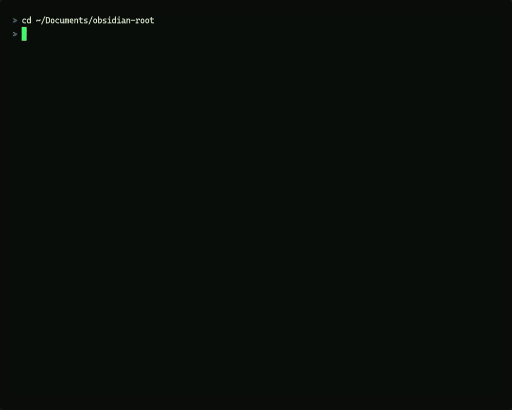
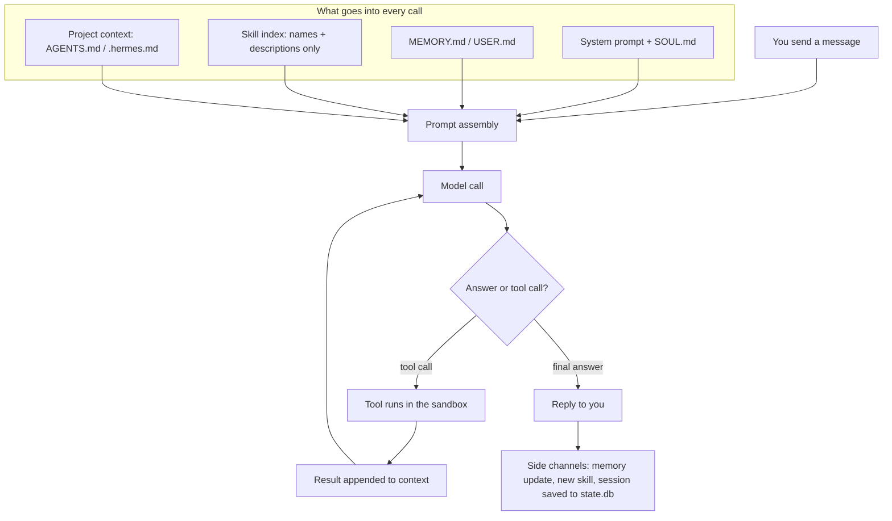

> A month ago I installed a terminal AI agent to answer one question: "what am I doing today?" It ended up writing code, opening PRs, and remembering my preferences better than some people I work with. 🤖

## Overview

For the last month I have been experimenting with [Hermes Agent](https://github.com/NousResearch/hermes-agent), an open-source agent harness from Nous Research that runs in your terminal — and, as I found out later than I should have, on your phone, in your editor, and inside your CI.

I did not set out to replace my whole workflow. I set out to make one annoying thing go away: the tiny admin loop of checking my calendar, my notes, and my project list every morning.

It worked. So well that it quietly grew into my daily driver for notes, code, and research.

This post is my honest impression after a month of real use: what I liked, how it works under the hood, what I got wrong, and the features I only discovered later.

## My Setup

My setup is deliberately boring and cheap:

| Piece         | My choice                                       | Why                                                     |
| ------------- | ----------------------------------------------- | ------------------------------------------------------- |
| Model         | DeepSeek `v4-flash` via API key, paid per token | Value for money. No subscription to justify every month |
| Harness       | Hermes Agent (`hermes --tui`)                   | Terminal-native, scriptable, customisable               |
| Isolation     | Docker terminal backend                         | One path in: my Obsidian vault                          |
| Customisation | My own skills, context files, and MCP servers   | This is the actual product, honestly                    |

I pay per token instead of holding a subscription, and this is where I notice the biggest difference compared to the subscription-based tools. `v4-flash` is not the strongest model on the market — but for open-source projects, note-keeping, and day-to-day assistant work, it is more than good enough, and I never think about the bill.

**The lesson I keep re-learning:** the model is one thing, the _harness_ is another, and the whole setup around it — skills, markdown instruction files, MCP servers — is a third. A great model in a dumb harness is worse than a good model wired into a setup that matches how you think.

I personally love customisation, so this is my favourite part: I get to write my own skills, my own flows, my own loops.

## The Docker Sandbox Saved My Configs

I run Hermes inside a separate Docker container, and I am not going back.

The reason is embarrassing and simple: one of my config files did not survive an over-eager AI agent that was supposed to install a desktop plugin. It left my configs in a state that was annoying and hard to spot. Fixing it was not hard, but I did not enjoy the surprise.

So now the agent lives in a box, and that box gets access to exactly one path: my Obsidian vault. Inside the vault I keep my own little "database" — meeting notes, calls, projects, and the decisions I would otherwise forget.

> **The sandbox is a config option, not a philosophy.** Hermes ships several terminal backends — local, Docker, SSH, Daytona, Modal, Vercel Sandbox — and switching to Docker is a one-line change. It turns an agent with shell access into an agent with _scoped_ shell access. See [Tools & terminal backends](https://hermes-agent.nousresearch.com/docs/user-guide/features/tools).

That was the whole pitch for me as a personal assistant. It does not need my entire home directory. It needs my notes.

## TUI, or the Classic CLI?

Hermes ships two interactive faces, and this confused me for a week, so here is the short version:

|             | Classic CLI (`hermes`) | TUI (`hermes --tui`)                                  |
| ----------- | ---------------------- | ----------------------------------------------------- |
| Built on    | `prompt_toolkit` REPL  | Ink-style terminal UI                                 |
| Ship status | The default            | Recommended for interactive use                       |
| Feels like  | A very good REPL       | A small app with panels                               |
| Overlays    | Inline flows           | Modal panels: model picker, session picker, approvals |
| Scrolling   | Normal scrollback      | Alternate screen — no clutter after you quit          |
| Mouse       | —                      | Drag to select, normal copy gesture                   |

What matters more than the differences: **it is the same agent underneath.** Same sessions, same slash commands, same skills, same memory. You can open a session in the TUI, quit, and resume it from the classic CLI — nothing is lost.

Switching is one flag (or one config line):

```bash
hermes --tui          # force the TUI for this run
hermes --cli          # drop back to the classic REPL
hermes --tui -c       # resume the last session, in the TUI
```

```yaml
# ~/.hermes/config.yaml
display:
  interface: tui # "cli" is the default
```

<details>
<summary>Why I ended up on the TUI (the small stuff that won me over)</summary>

- **It paints before it loads.** The first frame appears instantly, so the terminal never looks frozen while the agent boots.
- **Typing is never blocked.** I can start writing the next message while it is still thinking — my words queue instead of being dropped.
- **Prompt caching stays warm.** Neither interface rewrites the earlier part of the conversation, which is what keeps a pay-per-token setup cheap.
- **Pasting behaves like an app, not a prompt.** <kbd>Ctrl</kbd>+<kbd>V</kbd> pastes text, long snippets collapse inline instead of flooding the screen, and a copied screenshot arrives as an image.
- **Resume by what I remember.** `hermes --tui --resume "release notes"` is a better address than a session ID, and `--resume latest --in ./repo` finds the right one per project.

Read more in the [TUI guide](https://hermes-agent.nousresearch.com/docs/user-guide/tui) or the [CLI reference](https://hermes-agent.nousresearch.com/docs/user-guide/cli).

</details>

## A Normal Day

This is the interaction I now have most often:



That is it. That is the feature. It reads my vault, understands the structure, and hands me a summary I can read while the coffee is still brewing.

At this point I have stopped manually updating my calendar and my daily notes. I ask. It answers. Sometimes it writes the note for me.

## The Harness Matters More Than the Model

Over the past years of jumping between models and following every capability jump, my opinion shifted. In 2023 I thought the model was everything. Now I think the harness is what you actually live in.

Concretely, a harness decides:

- **what tools the model can call** — shell, browser, file read/write, subagents,
- **what context the model gets** — your rules, your memory, your project files,
- **how failure is handled** — retries, lint gates, review before commit,
- **and what the agent can learn** — this is the one most tools get wrong.

Hermes is good at the fourth point in a way I did not expect: it writes its own [skills](https://hermes-agent.nousresearch.com/docs/user-guide/features/skills). It notices a procedure it just executed successfully, and saves it as a reusable markdown skill for the next session. It also ships a setup wizard that walks you through the boring parts.

That combination — cheap model plus an opinionated harness that compounds — is why I am still using it after the novelty wore off.

## How It Actually Works

The loop is simpler than it looks, and understanding it changed how I write instructions for it.



Four things live in the prompt at all times: the system prompt, the memory files, a **skill index** (only names and descriptions, not the full bodies), and any project context files. Everything else — tool results, file contents, web pages — enters the context only when a tool call puts it there.

That is why the setup rewards discipline. Every file you add to the always-on prompt costs tokens on _every_ call. Every skill you add costs one line until it is actually needed.

<details>
<summary>Two details that surprised me</summary>

1. **The context is stable by design.** Hermes avoids rewriting the past parts of the conversation, which keeps the provider's prompt cache warm. On a paid-per-token model, that is the difference between "cheap" and "not cheap".[^1]
2. **Everything is searchable later.** Sessions are stored in a local SQLite database with full-text search, so "what did we decide about that migration two weeks ago?" is an actual question I can ask. See [Sessions](https://hermes-agent.nousresearch.com/docs/user-guide/sessions).

</details>

Context files are the part I under-used for the first two weeks: drop an `AGENTS.md` or `.hermes.md` into a repo and it is injected into every conversation started there — the project tells the agent how it wants to be treated. ([Context files](https://hermes-agent.nousresearch.com/docs/user-guide/features/context-files))

## The Part I Underrated: Skills

I expected skills to be prompt templates. They are closer to _procedural memory_: markdown procedures with a name, a one-line description, and a body that only loads when the agent decides the skill is relevant.

That mechanism — progressive disclosure — is why a large skill library does not blow up the context. Fifty skills cost fifty lines. The one that matters loads in full.

Practical consequences I did not appreciate at first:

- **Per-project context works without docs in the repo.** A skill (or a context file) can carry the architecture, the conventions, and the gotchas of a project. I start a session in a fresh clone and it picks up where it left off.
- **The skills get maintained.** Hermes ships a [curator](https://hermes-agent.nousresearch.com/docs/user-guide/features/curator) that tracks skill usage, flags stale ones, and archives the dead weight. Without it, my own skill folder would turn into a graveyard within two months.
- **Writing a skill is cheaper than repeating yourself.** Every time I catch myself explaining the same convention twice, that is a skill waiting to be written.

## It Starts to Know Me

This is the part that changed my mind about the whole category.

Over time the agent accumulates [memory](https://hermes-agent.nousresearch.com/docs/user-guide/features/memory): a small file about me and my preferences, and a compact list of standing facts — my timezone, my path layout, that I want notes in English even when I ask in Polish, that I hate author trailers in commits.

The result is subtle but real. Month one, I was giving it full context every single time. Month two, I open a session, say "continue with the release notes", and it already knows which repo, which convention, and which tone.

Two honest caveats:

- **Memory has a hard character budget.** It is not a wiki. Hermes keeps it small and replaces stale entries instead of appending forever. The detail belongs in my vault, not in memory.
- **It is only as good as what you tell it.** Memory that stays empty stays useless. When something annoys me twice, I write it down as a rule, and it stops happening.

The vault plus memory split is what makes this work: memory holds the rules, the vault holds the facts.

## Building Real Projects With It

Other than being a daily driver, I have shipped a few projects with Hermes, and this is where my custom skills paid off.

The loop I use:

1. **I am the director.** I write the instruction for a feature: what it does, what it must not break, and how I will verify it.
2. **It writes the code.** It reads the repo, follows the conventions from the context file, and edits.
3. **The gates catch the rest.** I set up pre-commit, pre-push hooks, and GitHub Actions on every project from the start. Typecheck, lint, tests. No project of mine merges without them.
4. **It commits and opens a PR.** With a written summary, so future me can read the history.
5. **I review.** Always. That part is not optional.

With a decent architecture from day one, this works surprisingly well. The architecture is doing the heavy lifting: small modules, clear boundaries, and a test suite that tells the agent when it is wrong.

The trick I use for parallel work is worktree mode — `hermes -w` gives the agent a disposable git worktree, so a second agent on the same repo cannot fight over my working copy.

## Research and Scraping

I also use Hermes a lot for research, and it is genuinely great at it.

It has a [real browser](https://hermes-agent.nousresearch.com/docs/user-guide/features/browser), not just an HTTP fetcher — so it can drive pages that need JavaScript, logins, and clicks. It scrapes, extracts, compares, and writes the result up. When a page fights back (bot walls, paywalls), the agent has a fallback ladder instead of giving up.

I have used it for: competitor teardowns, job-offer analysis, library comparisons, and "what changed in this release" checks. The output lands directly in the vault as a note I can read later.

## The Features I Completely Missed

Here is the part of the post I wish someone had written for me a month ago. This is the stuff I discovered late, and it is the reason I am writing this down.

| Feature                     | What it actually unlocks                                                                                                                                      | Docs                                                                                       |
| --------------------------- | ------------------------------------------------------------------------------------------------------------------------------------------------------------- | ------------------------------------------------------------------------------------------ |
| **Messaging gateway**       | The same agent, memory and tools on Telegram, Discord, Slack, WhatsApp, Signal, Email — 20+ platforms. Ask "what's on today" from your phone, not your laptop | [Messaging](https://hermes-agent.nousresearch.com/docs/user-guide/messaging)               |
| **Cron in plain English**   | `every weekday at 7:00: read my vault, send me a briefing` — runs before I wake up, delivers wherever I want                                                  | [Cron](https://hermes-agent.nousresearch.com/docs/user-guide/features/cron)                |
| **Voice mode + wake word**  | Real-time voice and a hands-free "Hey Hermes" — the right interface for "add milk to the shopping list" while cooking                                         | [Voice](https://hermes-agent.nousresearch.com/docs/user-guide/features/voice-mode)         |
| **Subagents**               | Isolated child agents with their own context: "check these eight offers and report back" without flooding my session with eight pages                         | [Delegation](https://hermes-agent.nousresearch.com/docs/user-guide/features/delegation)    |
| **Webhooks**                | A GitHub event triggers an agent run — a PR reviewer on demand, with no server of mine                                                                        | [Webhooks](https://hermes-agent.nousresearch.com/docs/user-guide/messaging/webhooks)       |
| **ACP**                     | The same agent inside VS Code, Zed, or JetBrains, if you prefer an editor over a terminal                                                                     | [ACP](https://hermes-agent.nousresearch.com/docs/user-guide/features/acp)                  |
| **OpenAI-compatible proxy** | A local endpoint backed by whatever provider you are signed into; any tool that speaks OpenAI can use it                                                      | [Proxy](https://hermes-agent.nousresearch.com/docs/user-guide/features/subscription-proxy) |
| **MCP servers**             | External tool servers, so the agent can reach systems it does not ship with                                                                                   | [MCP](https://hermes-agent.nousresearch.com/docs/user-guide/features/mcp)                  |
| **Mixed models**            | Routing presets and fallback providers, so a dead provider does not end the session                                                                           | [Providers](https://hermes-agent.nousresearch.com/docs/user-guide/configuration)           |

Two more that are less flashy but changed how I work:

- **Code execution.** Instead of ten round trips (read, read, read, write), the agent can write one Python script that calls the tools programmatically and come back with the answer. Same result, a fraction of the tokens. ([Code execution](https://hermes-agent.nousresearch.com/docs/user-guide/features/code-execution))
- **The docs are agent-readable.** `https://hermes-agent.nousresearch.com/docs/llms.txt` is a single index of every feature with a link to the page that explains it — I now paste that URL into the agent instead of describing what I want it to look up. It is a small thing that says a lot about who the project is built for.

Not all of these are things I run daily. All of them are things I will run the moment the use case shows up, and knowing they exist changes what I bother building myself.

## What Is Not Great

I would not trust a one-month review that is all praise, so:

- **You have to build your own flows.** The harness gives you the primitives. The value comes from your skills and your conventions, and that is work.
- **A cheap model is cheap for a reason.** On a small model, a loose instruction becomes a loose result. Tight prompts and gates matter more, not less.
- **The failure mode is silent competence.** It will happily do the wrong thing well. Review the diff, not the summary.
- **Customisation is a rabbit hole.** I have spent evenings tuning skills that saved me ten minutes. Enjoyable, not always rational.

## The Cost Reality

I am not going to quote a dollar figure I cannot defend — my usage is not your usage.

What I can say: for reading and writing notes, answering questions about my own data, and the occasional research session, my daily use is cheap enough that I stopped thinking about it. That "stopped thinking about it" part is the actual feature. I have cancelled subscriptions that cost more and delivered less.

The interesting insight is that I did not need a frontier model for this job. I need a model that is good at following instructions and calling tools, inside a harness that keeps it honest. When the harness carries the structure, the model gets to be a commodity — and that is a much better position to be in as a buyer.

## Final Thoughts

I will keep using Hermes as my daily assistant with a connection to my Obsidian vault. The potential is clear: I no longer update a calendar by hand, I no longer check three places to find out what my day looks like, and I no longer write the same instructions twice.

If you take one thing from this post, take the ordering:

1. **Pick the harness first.** It decides what the model can do.
2. **Give it one folder, not your whole machine.** Docker is your friend.
3. **Write the skills.** That is where your taste becomes the agent's behaviour.
4. **Keep the gates.** Lint, typecheck, tests, review. Always.

And then ask it what you are doing today. That is the gateway drug. 😄

If you want to try it: the [installation guide](https://hermes-agent.nousresearch.com/docs/getting-started/installation) is one `curl`, and the [repo](https://github.com/NousResearch/hermes-agent) is where the source lives. If you get stuck on skills, read [Work with skills](https://hermes-agent.nousresearch.com/docs/guides/work-with-skills) before you write your tenth one — it would have saved me a weekend.

Have a nice day, keep coding, and never stop learning! 🚀

[^1]: Cheap-model setups are boringly sensitive to this. When a harness rewrites the prefix of the conversation on every turn, the provider has to re-process everything from scratch, and the bill quietly triples. I learned this the hard way with a much dumber setup before this one.
