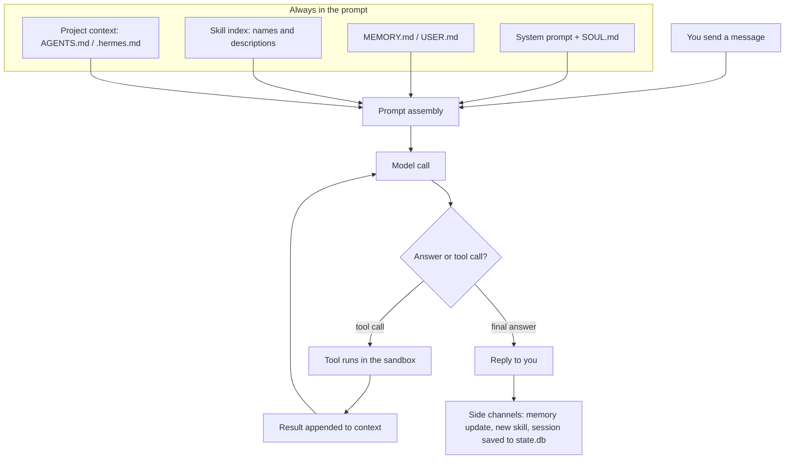

> A month ago I installed a terminal AI agent to answer one question: "what am I doing today?" It ended up writing code, opening PRs, and remembering my preferences better than some people I work with. 🤖

Every morning I ran the same tiny loop: calendar, notes, project list, then a guess at what the day actually looked like. Three tabs to answer a question I already knew the answer to.

So I installed [Hermes Agent](https://github.com/NousResearch/hermes-agent), an open-source agent harness from Nous Research that runs in your terminal — and, as I found out later than I should have, on your phone, in your editor, and inside your CI. I was not trying to replace my workflow. I was trying to delete one annoying loop.

It worked well enough to become my daily driver for notes, code, and research. This is the honest version of that month: what I liked, how it works inside, what I got wrong, and the features I only found late.

## The Setup

Deliberately boring and cheap:

| Piece         | My choice                                       | Why                                                     |
| ------------- | ----------------------------------------------- | ------------------------------------------------------- |
| Model         | DeepSeek `v4-flash` via API key, paid per token | Value for money. No subscription to justify every month |
| Harness       | Hermes Agent (`hermes --tui`)                   | Terminal-native, scriptable, customisable               |
| Isolation     | Docker terminal backend                         | One path in: my Obsidian vault                          |
| Customisation | My own skills, context files, and MCP servers   | This is the actual product, honestly                    |

Paying per token is where I notice the biggest difference from subscription tools. `v4-flash` is not the strongest model on the market, but for open-source projects, note-keeping, and day-to-day assistant work it is more than good enough — and I never think about the bill.

**The lesson I keep re-learning:** the model is one thing, the _harness_ is another, and the setup around it — skills, markdown instruction files, MCP servers — is a third. A great model in a dumb harness loses to a good model wired into a setup that matches how you think. I like customising things, so that last layer is my favourite part: my own skills, my own flows, my own loops.

## The Sandbox Is a Config Option, Not a Philosophy

One of my config files did not survive an over-eager agent that was supposed to install a desktop plugin. It left things in a state that was annoying and hard to spot. Fixing it was easy; the surprise is what I remember.

So the agent lives in a box now, and that box gets exactly one path: my Obsidian vault. Inside the vault I keep my own little database — meeting notes, calls, projects, and the decisions I would otherwise forget.

> **The sandbox is a config option, not a philosophy.** Hermes ships several terminal backends — local, Docker, SSH, Daytona, Modal, Vercel Sandbox — and switching to Docker is a one-line change. It turns an agent with shell access into an agent with _scoped_ shell access. See [Tools & terminal backends](https://hermes-agent.nousresearch.com/docs/user-guide/features/tools).

That was the whole pitch for me as a personal assistant. It does not need my home directory. It needs my notes.

## Two Interfaces, One Agent

Hermes ships two interactive faces, and the difference confused me for a week:

|            | Classic CLI (`hermes`) | TUI (`hermes --tui`)                                  |
| ---------- | ---------------------- | ----------------------------------------------------- |
| Built on   | `prompt_toolkit` REPL  | Ink-style terminal UI                                 |
| Feels like | A very good REPL       | A small app with panels                               |
| Overlays   | Inline flows           | Modal panels: model picker, session picker, approvals |
| Scrolling  | Normal scrollback      | Alternate screen — no clutter after you quit          |
| Mouse      | —                      | Drag to select, normal copy gesture                   |

What matters more: **it is the same agent underneath.** Same sessions, same slash commands, same skills, same memory. Open a session in the TUI, quit, resume it from the classic CLI — nothing is lost. The TUI is the recommended interface for interactive use; the CLI stays the default.

Switching is one flag, or one config line:

```bash
hermes --tui          # force the TUI for this run
hermes --cli          # drop back to the classic REPL
hermes --tui -c       # resume the last session, in the TUI
```

```yaml
# ~/.hermes/config.yaml
display:
  interface: tui # "cli" is the default
```

<details>
<summary>Small things that won me over</summary>

- **It paints before it loads**, so the terminal never looks frozen while the agent boots.
- **Typing is never blocked** — the next message queues while the agent is thinking.
- **Pasting behaves like an app**, not a prompt: <kbd>Ctrl</kbd>+<kbd>V</kbd> pastes text, long snippets collapse, a copied screenshot arrives as an image.
- **Resume by what I remember.** `hermes --tui --resume "release notes"` is a better address than a session ID, and `--resume latest --in ./repo` finds the right one per project.

Read more in the [TUI guide](https://hermes-agent.nousresearch.com/docs/user-guide/tui) or the [CLI reference](https://hermes-agent.nousresearch.com/docs/user-guide/cli).

</details>

## A Normal Day


That is the whole interaction. It reads the vault, understands the structure, and hands me a summary I can read while the coffee is still brewing. I have stopped updating my calendar and my daily notes by hand. I ask, it answers, and sometimes it writes the note for me.

## What Goes Into Every Call

The loop is simpler than it looks, and understanding it changed how I write instructions for it.



Four things are always in the prompt:

- **The system prompt plus `SOUL.md`** — the agent's own persona file.
- **`MEMORY.md` and `USER.md`** — the compact standing facts about me and the work.
- **A skill index** — names and descriptions only, never the full bodies.
- **Project context files** — an `AGENTS.md` or `.hermes.md` found in the repo.

Everything else — tool results, file contents, web pages — enters only when a tool call puts it there. That is why setup rewards discipline. Every file added to the always-on prompt costs tokens on _every_ call. Every skill costs one line until it is actually needed.

<details>
<summary>Two details that surprised me</summary>

1. **The context is stable by design.** Hermes avoids rewriting the past parts of the conversation, which keeps the provider's prompt cache warm. On a pay-per-token model that is the difference between "cheap" and "not cheap".[^1]
2. **Everything is searchable later.** Sessions live in a local SQLite file (`state.db`) with full-text search, so "what did we decide about that migration two weeks ago?" is a question I can actually ask. See [Sessions](https://hermes-agent.nousresearch.com/docs/user-guide/sessions).

</details>

Context files are the part I under-used for two weeks: drop an `AGENTS.md` or `.hermes.md` into a repo and it is injected into every conversation started there, so the project tells the agent how it wants to be treated. ([Context files](https://hermes-agent.nousresearch.com/docs/user-guide/features/context-files))

## Skills Are Procedural Memory

I expected skills to be prompt templates. They are closer to procedural memory: markdown procedures with a name, a one-line description, and a body that loads only when the agent decides it is relevant.

That mechanism — progressive disclosure — is why a large skill library does not blow up the context. Fifty skills cost fifty lines. The one that matters loads in full.

Hermes also writes its own [skills](https://hermes-agent.nousresearch.com/docs/user-guide/features/skills): when a procedure succeeds, it can save it as a reusable markdown file for the next session. That is the part most tools get wrong, and the one I did not expect.

Three consequences I did not appreciate at first:

- **Per-project context works without docs in the repo.** A skill or context file can carry the architecture, the conventions, and the gotchas. I start a session in a fresh clone and it picks up where it left off.
- **The skills get maintained.** Hermes ships a [curator](https://hermes-agent.nousresearch.com/docs/user-guide/features/curator) that tracks skill usage, flags stale ones, and archives the dead weight. Without it my skill folder would be a graveyard in two months.
- **Writing a skill beats repeating yourself.** Every time I explain the same convention twice, that is a skill waiting to be written.

## It Starts to Know Me

This is the part that changed my mind about the whole category. Over time the agent accumulates [memory](https://hermes-agent.nousresearch.com/docs/user-guide/features/memory): `USER.md`, a small file about me and my preferences, and `MEMORY.md`, a compact list of standing facts — my timezone, my path layout, that I want notes in English even when I ask in Polish, that I hate author trailers in commits.

The result is subtle but real. Month one, I gave it full context every single time. Month two, I open a session, say "continue with the release notes", and it already knows which repo, which convention, and which tone.

Two caveats:

- **Memory has a hard character budget.** It is not a wiki. Hermes keeps it small and replaces stale entries instead of appending forever. Details belong in the vault, not in memory.
- **It is only as good as what you tell it.** When something annoys me twice, I write it down as a rule, and it stops happening.

That is the split that makes this work: memory holds the rules, the vault holds the facts.

## Shipping Real Projects With It

The custom skills pay off here. My loop:

1. **I am the director.** I write the instruction: what the feature does, what it must not break, how I will verify it.
2. **It writes the code.** It reads the repo, follows the context file's conventions, and edits.
3. **The gates catch the rest.** Pre-commit, pre-push hooks, and GitHub Actions on every project from day one. Typecheck, lint, tests.
4. **It commits and opens a PR**, with a written summary, so future me can read the history.
5. **I review.** Always. That part is not optional.

With a decent architecture this works surprisingly well, and the architecture is doing the heavy lifting: small modules, clear boundaries, a test suite that tells the agent when it is wrong. For parallel work I use worktree mode — `hermes -w` gives the agent a disposable git worktree, so a second agent on the same repo cannot fight over my working copy.

## It Is Also Good at Research

I use Hermes for research a lot, and it is genuinely great at it. It has a [real browser](https://hermes-agent.nousresearch.com/docs/user-guide/features/browser), not just an HTTP fetcher, so it drives pages that need JavaScript, logins, and clicks. When a page fights back — bot walls, paywalls — the agent has a fallback ladder instead of giving up.

I have used it for competitor teardowns, job-offer analysis, library comparisons, and "what changed in this release" checks. The output lands in the vault as a note I can read later.

## What I Missed for a Month

The part I wish someone had written for me. These are the features I found late, and the reason this post exists.

| Feature                     | What it unlocks                                                                                                      | Docs                                                                                       |
| --------------------------- | -------------------------------------------------------------------------------------------------------------------- | ------------------------------------------------------------------------------------------ |
| **Messaging gateway**       | The same agent, memory and tools on 20+ platforms. Ask "what's on today" from your phone, not your laptop            | [Messaging](https://hermes-agent.nousresearch.com/docs/user-guide/messaging)               |
| **Cron in plain English**   | `every weekday at 7:00: read my vault, send me a briefing` — runs before I wake up, delivers wherever I want         | [Cron](https://hermes-agent.nousresearch.com/docs/user-guide/features/cron)                |
| **Subagents**               | Isolated child agents with their own context: "check these eight offers and report back" without flooding my session | [Delegation](https://hermes-agent.nousresearch.com/docs/user-guide/features/delegation)    |
| **Webhooks**                | A GitHub event triggers an agent run — a PR reviewer on demand, with no server of mine                               | [Webhooks](https://hermes-agent.nousresearch.com/docs/user-guide/messaging/webhooks)       |
| **OpenAI-compatible proxy** | A local endpoint backed by whatever provider you are signed into; any tool that speaks OpenAI can use it             | [Proxy](https://hermes-agent.nousresearch.com/docs/user-guide/features/subscription-proxy) |

<details>
<summary>The rest of the list</summary>

- **Voice mode and wake word** — real-time voice and a hands-free "Hey Hermes", the right interface for "add milk to the shopping list" while cooking. ([Voice](https://hermes-agent.nousresearch.com/docs/user-guide/features/voice-mode))
- **ACP** — the same agent inside VS Code, Zed, or JetBrains, if you prefer an editor over a terminal. ([ACP](https://hermes-agent.nousresearch.com/docs/user-guide/features/acp))
- **MCP servers** — external tool servers, so the agent reaches systems it does not ship with. ([MCP](https://hermes-agent.nousresearch.com/docs/user-guide/features/mcp))
- **Mixed models** — routing presets and fallback providers, so a dead provider does not end the session. ([Providers](https://hermes-agent.nousresearch.com/docs/user-guide/configuration))

</details>

Two less flashy ones changed how I work:

- **Code execution.** Instead of ten round trips (read, read, read, write), the agent writes one Python script that calls the tools programmatically. Same result, a fraction of the tokens. ([Code execution](https://hermes-agent.nousresearch.com/docs/user-guide/features/code-execution))
- **Agent-readable docs.** [`llms.txt`](https://hermes-agent.nousresearch.com/docs/llms.txt) is a single index of every feature with a link to the page that explains it. I paste that URL into the agent instead of describing what I want it to look up. Small thing, says a lot about who the project is built for.

Not all of these run daily. All of them run the moment the use case shows up, and knowing they exist changes what I bother building myself.

## What Is Not Great

A one-month review that is all praise is not a review.

- **You build your own flows.** The harness gives you primitives. The value comes from your skills and conventions, and that is work.
- **A cheap model is cheap for a reason.** On a small model a loose instruction becomes a loose result, so tight prompts and gates matter more, not less.
- **The failure mode is silent competence.** It will happily do the wrong thing well, and the summary will sound confident. Review the diff, not the summary.

  [AUTHOR: replace with the one concrete example — the PR or diff where it was confidently wrong, and what the review caught]

- **Customisation is a rabbit hole.** I have spent evenings tuning skills that saved me ten minutes. Enjoyable, not always rational.

## What It Costs

I will not quote a dollar figure I cannot defend — my usage is not your usage. What I can say: for reading and writing notes, answering questions about my own data, and the occasional research session, daily use is cheap enough that I stopped thinking about it. That "stopped thinking about it" is the actual feature. I have cancelled subscriptions that cost more and delivered less.

The insight is that this job never needed a frontier model. It needs a model that follows instructions and calls tools reliably, inside a harness that keeps it honest. When the harness carries the structure, the model gets to be a commodity — a much better position to be in as a buyer.

## Where to Start

If you take one thing from this post, take the ordering:

1. **Pick the harness first.** It decides what the model can do.
2. **Give it one folder, not your whole machine.** Docker is your friend.
3. **Write the skills.** That is where your taste becomes the agent's behaviour.
4. **Keep the gates.** Lint, typecheck, tests, review. Always.

Then ask it what you are doing today. That is the gateway drug. 😄

The [installation guide](https://hermes-agent.nousresearch.com/docs/getting-started/installation) is one `curl`, and the [repo](https://github.com/NousResearch/hermes-agent) is where the source lives. If you get stuck on skills, read [Work with skills](https://hermes-agent.nousresearch.com/docs/guides/work-with-skills) before you write your tenth one — it would have saved me a weekend.

Have a nice day, keep coding, and never stop learning! 🚀

[^1]: Cheap-model setups are boringly sensitive to this. When a harness rewrites the prefix of the conversation on every turn, the provider re-processes everything from scratch, and the bill quietly triples. I learned that the hard way with a much dumber setup before this one.
