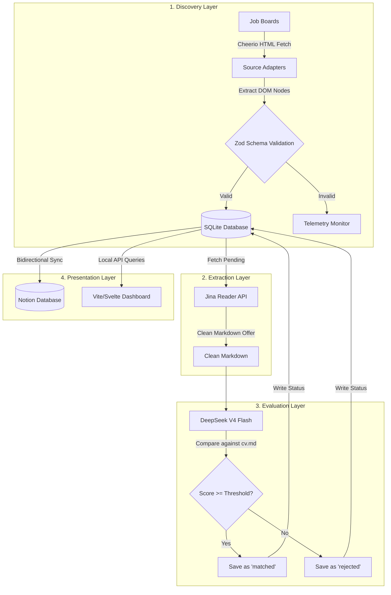

## Overview

I really enjoy solving problems. More than that, I like to simplify and optimize. That is exactly why I built **JobETL**.

The problem was simple: finding a high-quality job that fits my knowledge, experience, and expectations was costing me hours of manual scrolling and reading. Opening dozens of job boards, filtering out irrelevant listings, and reading repetitive requirements is a massive waste of time.

The solution? An intelligent, local-first tool that takes my experience (`cv.md`), compares it directly against crawled job descriptions, scores the match using an LLM, and presents everything in a clean dashboard.

Here is how I designed, built, and optimized this pipeline.

---

## The Core Architecture

JobETL is split into four distinct layers to keep it fast, modular, and resilient. Instead of building a heavy, fragile scraper, the pipeline flows cleanly from raw HTML to an interactive dashboard.



### 1. Discovery & Validation (Cheerio + Zod)

First, we need to extract job links quickly.

- **Cheerio** is used to rapidly download and parse HTML search result pages. It is lightweight, fast, and does not require spinning up a heavy headless browser like Puppeteer.
- **Zod** acts as our structural firewall. Job boards frequently update their DOM class names and structures, which silently breaks scrapers. Every parsed job listing is passed through a strict Zod schema (`JobListingSchema`). If a board changes its layout and our scraper misses a title or company, Zod catches the validation error immediately and reports it via a **Telemetry** system instead of silently corrupting the database.

### 2. Deep Extraction (Jina Reader)

Once we have a valid list of job URLs, we need the full text of the description.

- Writing custom scrapers for four different job boards just to grab description text is a maintenance nightmare. Instead, the pipeline hits the **Jina Reader API** (`https://r.jina.ai/`).
- Jina visits the URL, bypasses basic bot protections, strips out noisy HTML elements (headers, footers, cookie banners), and returns clean Markdown.

### 3. AI Evaluation (DeepSeek V4)

With the clean description Markdown in hand, the system scores the offer against my CV.

- We use **DeepSeek V4 (`deepseek-v4-flash`)** via the **Vercel AI SDK** (`generateObject`) to output a structured JSON response.
- The model compares the job markdown with my local `cv.md` and yields:
  - A match score between `0` and `1`.
  - A short reason for the score.
  - A summary outlining key requirements, missing skills, and overall compatibility.
- DeepSeek provides GPT-4 level intelligence at a fraction of the cost, making bulk-scoring hundreds of jobs highly affordable.

### 4. Storage & Presentation (SQLite + Drizzle ORM)

Everything is saved locally to ensure we do not re-scrape or re-evaluate the same listings.

- **SQLite** stores the listings locally in `./data/jobetl.db`.
- **Drizzle ORM** manages the schema and handles strict TypeScript queries, providing high compile-time safety and painless refactoring.

---

## How the Project Evolved

The project did not start as a polished app. It went through several major iterations:

1. **The SQLite Script:** At first, it was a simple CLI script saving raw listings to a local SQLite database.
2. **Notion Integration:** To make review easier, I connected the backend to a Notion Database. The pipeline pushed the jobs directly to Notion so I could read, filter, and track them from a beautiful, pre-built kanban interface.
3. **The Svelte 5 Web UI:** Eventually, I wanted a dedicated, local dashboard to read full job descriptions next to the match summaries without leaving my browser. I wrote a Svelte 5 + Tailwind CSS v4 frontend.
4. **Zod & Telemetry Refactoring:** When scrapers began failing due to structural layout changes on job boards, I added strict Zod schemas and a telemetry logging system to catch DOM drift instantly.

---

## Technical Decisions: Why This Stack?

When refactoring the project, I prioritized speed, developer experience, and code safety.

### Svelte 5 & Runes

The dashboard frontend was migrated from a fragile, 1,000-line monolithic HTML dashboard to **Svelte 5**. Svelte's new **Runes** (`$state`, `$derived`, `$derived.by`) allow for highly readable and reactive state management:

```svelte
<script lang="ts">
  let allJobs = $state<StoredJob[]>([]);
  let currentFilter = $state<"matched" | "all" | "rejected">("matched");

  // Clean, reactive derived filtering
  const filteredJobs = $derived.by(() => {
    return allJobs.filter((job) => {
      if (currentFilter === "matched") return job.status === "matched";
      if (currentFilter === "rejected") return job.status === "rejected";
      return true;
    });
  });
</script>
```

This eliminated manual DOM manipulation entirely and split the UI into clean, maintainable components like `JobCard`, `Metrics`, `Drawer`, and `Sidebar`.

### Tailwind CSS v4

For styling, I adopted **Tailwind CSS v4**. Its new CSS-first configuration makes defining design systems straightforward. I used `@theme` declarations inside `app.css` to build a dark/light terminal-inspired aesthetic:

```css
@import 'tailwindcss';

@theme {
  --color-bg-base: #1c1b1a;
  --color-bg-surface: #242322;
  --color-accent: #d9b89c;
  --color-success: #a3e635;
  --color-danger: #f43f5e;
}
```

### GitHub Actions Automation

I set up a daily GitHub Actions cron workflow (`daily-crawl.yml`). Every day, it:

1. Rebuilds the local SQLite state from my Notion database (to preserve manual changes like the "Applied" status).
2. Crawls the latest listings from **4 services**: `justjoin.it`, `nofluffjobs`, `bulldogjob`, and `pracuj.pl`.
3. Validates, extracts, and scores new offers.
4. Syncs the updated data back to Notion.

Since `cv.md` contains personal information and is gitignored, the workflow reads the CV from a GitHub Actions secret (`CV_MARKDOWN`) and writes it to disk dynamically.

---

## The Dashboard Experience

The Svelte-powered UI provides a high-fidelity control center for my job hunt.


_(Placeholder: The local Svelte dashboard showing metrics, filters, and job lists)_

- **Metrics Panel:** Displays total evaluated count, matched opportunities, average match score, and reject rate.
- **Search & Filters:** Search by title or company, filter by match status, and toggle specific source boards on/off.
- **Drawer View:** Clicking any job opens a drawer containing the Jina-extracted Markdown description alongside a direct link, salary information, and the AI's feedback on what skills are missing from my resume.
- **Application Tracking:** Directly toggle the "Applied" state from the dashboard, syncing bidirectionally with Notion.

---

## Future Roadmap

There are two primary improvements I plan to introduce to the project next:

### 1. AWS Conversational Agent

While the current GitHub Actions workflow is highly reliable, I plan to migrate the architecture to a stateful, 24/7 **AWS EC2 instance**. By centralizing the system on EC2, the batch ETL pipeline and a conversational Telegram/Discord bot can share the exact same local SQLite database. This will allow me to receive instant push alerts for highly matching jobs, query the database, and trigger crawlers via chat with zero latency.

### 2. LLM Scoring: Contextual RAG

Currently, `DeepSeekMatcher` scores offers against a static Markdown CV zero-shot. I plan to implement **RAG (Retrieval-Augmented Generation)** using an embedded vector database (like Chroma or SQLite `vss`). By retrieving past binary decisions (`isApplied: true/false`) and injecting them into the LLM prompt context to condition the scoring criteria, the model's evaluations can be dynamically aligned with real-world application behavior, drastically improving the signal-to-noise ratio without modifying model weights.

---

## Final Thoughts

Automating my job search with JobETL saved me from scrolling through endless job posts and reading repetitive descriptions. Splitting the codebase into distinct layers—discovery, extraction, intelligence, and presentation—created a robust system that is easy to extend.

If you find yourself opening dozens of tabs to search for roles, building a personal ETL pipeline is one of the most practical solutions you can build.

Have a nice day, keep coding, and never stop learning! 🚀
