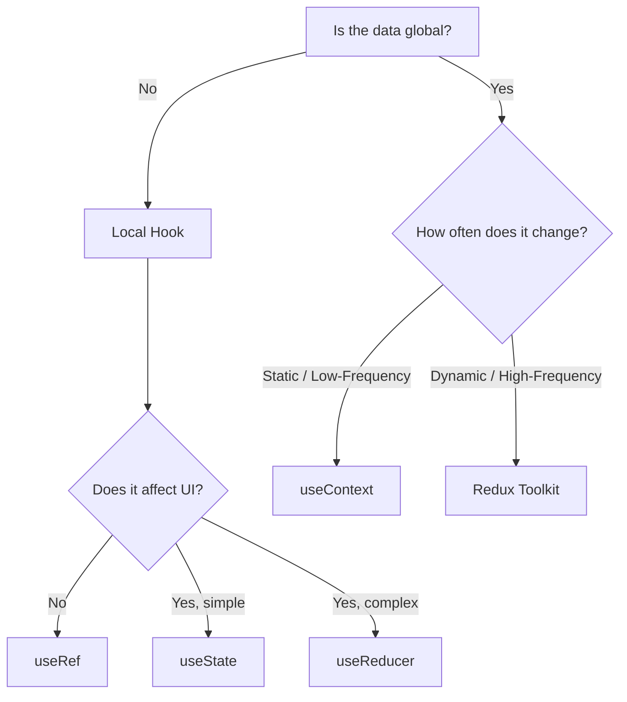

> You don't need to fear React state management. You just need the right mental model — and a good cup of coffee. ☕

## Overview

Modern web applications require managing complex data flows. Between local hooks (`useState`, `useReducer`, `useRef`), native Context API (`useContext`), and external libraries like Redux Toolkit (RTK), it is easy to suffer from analysis paralysis.

A common dilemma is determining whether these tools are mutually exclusive. _If I have Redux, is using `useContext` an anti-pattern? Do I need both? Where does local state fit in?_

Let’s build a clear, production-ready framework to categorize, compare, and architecturally align these tools.

---

## The Landscape of State

To understand where each tool fits, we must evaluate them across three axes:

1. **Scope:** Where does the state live and who has access to it?
2. **Frequency of Updates:** How often does the value change?
3. **Re-render Mechanism:** Does a change force the UI to repaint?

| Tool              | Scope                     | Update Frequency | Re-render Trigger           | The Coffee Shop Analogy                                                             |
| :---------------- | :------------------------ | :--------------- | :-------------------------- | :---------------------------------------------------------------------------------- |
| **`useRef`**      | Local Component           | High (or any)    | ❌ No                       | The notepad where you jot down a customer's jacket color.                           |
| **`useState`**    | Local Component           | Low-to-Medium    | Yes (self only)             | The cup in your hand—updates when you drink or refill.                              |
| **`useReducer`**  | Local Component           | Low-to-Medium    | Yes (self only)             | The order queue board behind the counter showing "Received" -> "Brewing" -> "Done". |
| **`useContext`**  | Component Tree (Sub-tree) | Low/Static       | Yes (all consumers)         | The ambient background music—everyone in the shop hears it, changes rarely.         |
| **Redux Toolkit** | Application-wide (Global) | High             | Yes (subscribed components) | The master ticket system synced across the register, kitchen, and pickup stations.  |

---

## Local State: useState vs. useReducer vs. useRef

Before dealing with global state, we must manage the component itself.

### `useRef` — The Silent Reference

`useRef` is a wrapper around a mutable value (`.current`) that persists between renders but does not trigger a re-render when changed.

```jsx
// Tracks click counts without forcing the component to redraw
const clickCount = useRef(0);

const handleClick = () => {
  clickCount.current += 1; // UI doesn't update, but the value is preserved
};
```

- **When to use:** Storing timer IDs (e.g., `setInterval`), DOM element references, or tracking previous prop/state values.

### `useState` — The UI Driver

`useState` is the default mechanism for storing data that changes over time and needs to be reflected immediately in the UI.

- **When to use:** Local toggle states (modals, dropdowns), temporary text input values, or loading states.
- **The Trap:** Avoid updating a parent's state on every keystroke if only a child input needs it. Keep state as local as possible.

### `useReducer` — The State Machine

When a component's state transitions become complex or depend on previous state keys, `useState` gets messy. `useReducer` decouples state modification logic from the component rendering.

```jsx
const initialState = { status: 'idle', beans: 10, coffeeServed: 0 };

function coffeeReducer(state, action) {
  switch (action.type) {
    case 'brew':
      if (state.beans < 1) return { ...state, status: 'out_of_beans' };
      return {
        ...state,
        beans: state.beans - 1,
        coffeeServed: state.coffeeServed + 1,
        status: 'brewed',
      };
    case 'restock':
      return { ...state, beans: state.beans + action.payload };
    default:
      throw new Error(`Unknown action: ${action.type}`);
  }
}
```

- **When to use:** State trees with multiple sub-values, or where the next state is a complex calculation of the previous state.

---

## Global Communication: useContext vs. Redux Toolkit

This is where the most common architectural confusion lies. `useContext` and Redux are **not** equivalent tools.

### `useContext` is NOT State Management

The Context API is a **dependency injection** and transport mechanism. It does not manage state; it merely passes state (created via `useState` or `useReducer`) down a component tree without manually passing props at every level.

#### The Re-render Catch

When a context value changes, **every single component consuming that context is forced to re-render**.

```jsx
// ❌ Performance Trap: Changing language forces user profile component to re-render
const AppContext = React.createContext();

function AppProvider({ children }) {
  const [theme, setTheme] = useState('dark');
  const [language, setLanguage] = useState('en');
  const [user, setUser] = useState({ name: 'Dan' });

  return (
    <AppContext.Provider value={{ theme, setTheme, language, setLanguage, user, setUser }}>
      {children}
    </AppContext.Provider>
  );
}
```

If you call `setTheme`, the `UserProfile` component (which only cares about `user`) will re-render because the overall `AppContext` value object changed reference.

### Redux Toolkit (RTK) — The Fine-Grained Subscription Engine

Redux stores state in a single, centralized object tree. Components do not read this tree directly; they use **selectors** to subscribe to exact slices of state.

```jsx
// Component only re-renders if state.auth.user changes
const user = useSelector((state) => state.auth.user);
```

If another slice of Redux state changes (like `state.theme`), components subscribed to `state.auth.user` **will not re-render**.

---

## Coexistence Strategy: What Belongs Where?

Using `useContext` and Redux in the same project is **not** an anti-pattern. It is actually a best practice when separated by frequency and purpose.



### 1. When to use `useContext` inside a Redux Project

Context is ideal for environmental values that do not change during a user session (or change very rarely):

- **Theme Configuration:** Dark vs. Light mode.
- **Internationalization:** Selected language locale (`en`, `es`).
- **Third-Party Providers:** Firebase client instances, Auth0 configurations, styled-components theme objects.
- **Component Libraries:** Exposing internal state to sub-components (e.g., `<Tabs>` injecting active index to `<Tab>`).

### 2. When to use Redux Toolkit

Use RTK for dynamic, relational data that drives the application's business logic:

- **Server Cache:** Fetching, caching, and updating API data (handled efficiently via RTK Query).
- **Multi-step transactional flows:** Checkout carts, user onboarding, multi-view dashboards.
- **Cross-cutting status updates:** Global notification systems, real-time web-socket feeds.

### The True Anti-Patterns to Avoid

1. **The Custom Context Wrapper:** Re-creating a global state library by wrapping `useContext` in multiple `useState` hooks when you already have Redux. This leads to redundant state synchronizations and performance degradation.
2. **Redux for Transient Input State:** Dispatching a Redux action on every keystroke of a search input or a local form. Keep form values in `useState` until submission.
3. **Monolithic Contexts:** Putting all global configurations into one huge `GlobalContext`. If you must use Context for multiple domains (e.g., Auth, Theme, Locale), split them into separate, small providers to avoid unnecessary re-render triggers.

---

## Summary

React architecture is about selecting the **right tool for the right scope**.

- Use **`useState` / `useReducer`** for local component UI.
- Use **`useRef`** when you need persistent memory without UI reaction.
- Use **`useRef`** or **`useState`** at the component level.
- Use **`useContext`** to inject static or low-frequency environment values.
- Use **Redux Toolkit** to sync and select dynamic global application data.

By classifying your data by scope and update frequency, you ensure your React app remains highly performant, testable, and maintainable.
